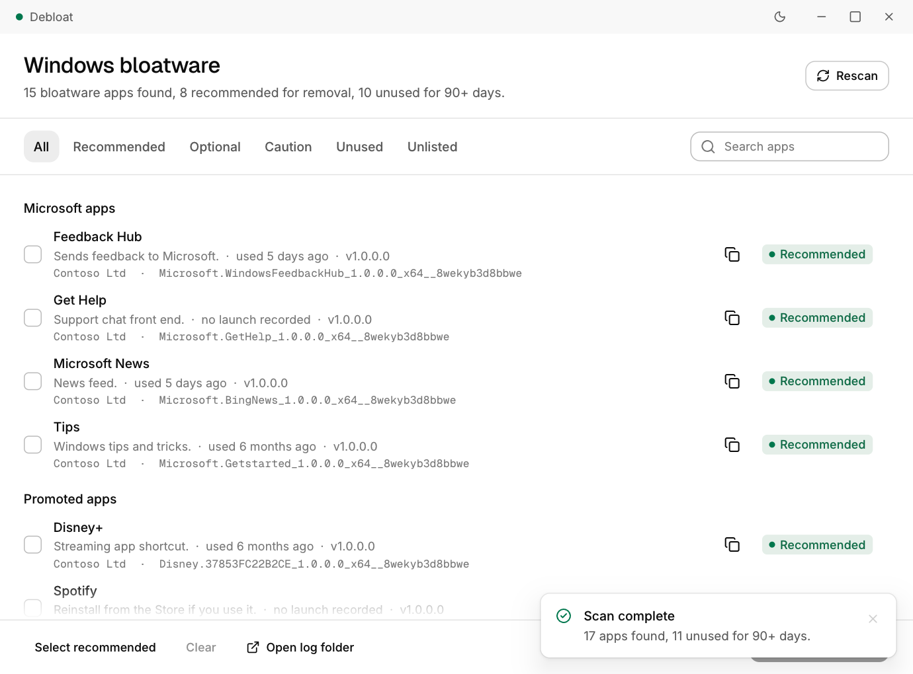
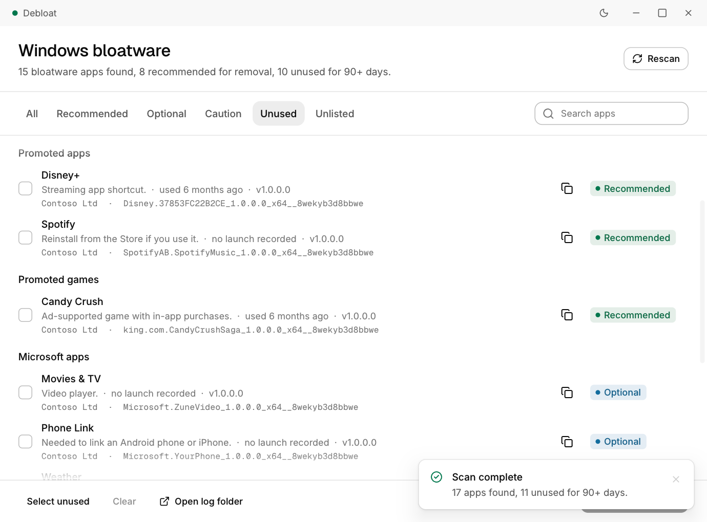
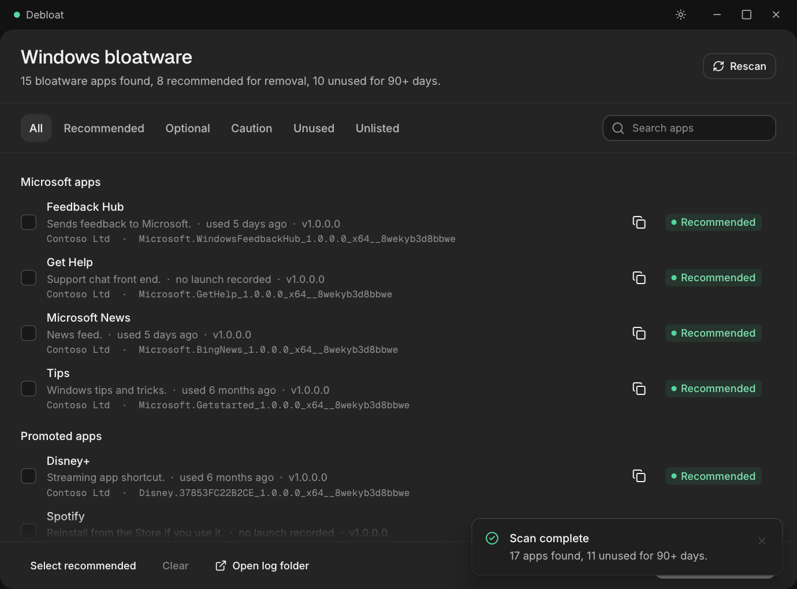

# Debloat

A small, portable Windows app that finds **bloatware**, **unused apps** and **unlisted apps** installed for your account, and lets you remove them safely. No installer, no admin rights, no account.

**[Download the latest Debloat.exe](https://github.com/anplusdre/debloat/releases/latest)** and double-click it.



## Features

- **Bloatware detection**: matches your installed Store apps against a curated list of about 70 entries: promoted games and apps (Candy Crush, Spotify, Netflix, TikTok), trial antivirus, and Microsoft apps few people open (News, Tips, Feedback Hub, Get Help, Skype).
- **Risk levels**: every app is labelled *Recommended*, *Optional* or *Caution* (Xbox, Media Player and other things Windows builds features on).
- **Unused apps**: flags apps not launched for 90+ days, using Windows' own launch history, and shows "used 6 months ago" per app.
- **Unlisted apps**: shows other removable apps that aren't on the list, with their real name, publisher and install folder (copy the full path with one click), so cryptic package IDs like `7EE7776C.SomeApp` are easy to identify. System components, runtimes, codecs and drivers are filtered out.
- **Safe removal**: a confirmation dialog lists exactly what will go, with stronger warnings for Caution and Unlisted items. Progress is live, and the list updates immediately after removal.
- **Log**: every removal is written to `%LOCALAPPDATA%\Debloat\removed.log` (the "Open log folder" button opens it).
- Light and dark theme, search and filters.

| Unused apps | Dark theme |
|---|---|
|  |  |

## Safety

- **Allowlist only.** An app is offered for removal only if it is on the built-in list, or (as *Unlisted*, never bulk-selected) if it is a removable app that doesn't look like a system component. Anything Windows marks as non-removable, a framework or a system package is never shown.
- **Your account only.** Removal needs no administrator rights and doesn't modify Windows itself.
- **Reversible.** Every app can be reinstalled from the Microsoft Store. A System Restore point wouldn't help here, because it doesn't track per-user Store apps.
- **Nothing is sent anywhere.** Debloat runs entirely on your PC and makes no network connections.
- "Unused" is a hint, not proof: launch history can be cleared by cleanup tools.

## Install and use

1. Download `debloat.exe` from the [latest release](https://github.com/anplusdre/debloat/releases/latest).
2. Run it. It scans automatically.
3. Pick apps (or click **Select recommended**), then **Remove selected** and confirm.

To uninstall Debloat, delete the exe. The log folder `%LOCALAPPDATA%\Debloat` can be deleted too.

**Windows SmartScreen:** the exe is not code-signed, so Windows may show "Windows protected your PC". Click *More info*, then *Run anyway*. Some antivirus tools may also flag unsigned apps that uninstall other apps. You can check your download against `SHA256SUMS.txt` from the release:

```powershell
Get-FileHash .\debloat.exe -Algorithm SHA256
```

Requires Windows 10 or 11 (with Windows PowerShell, which is built in).

## License and source

Copyright (c) 2026 Andre Ramadhan. Free to download and use. The source code is not published. Third-party notices are in [THIRD_PARTY_NOTICES.txt](THIRD_PARTY_NOTICES.txt).
